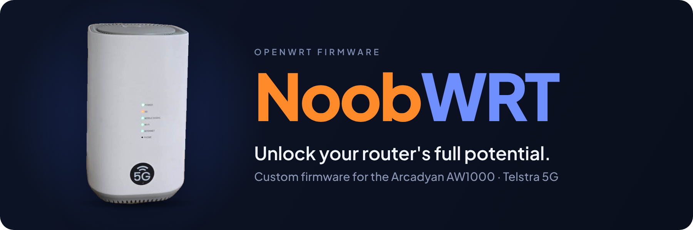
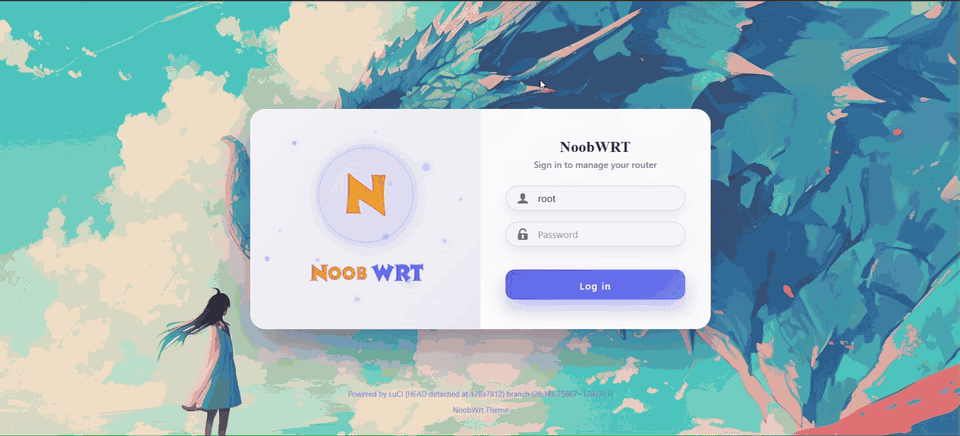

# NoobWRT for Arcadyan AW1000

**High-performance, fully customized OpenWrt firmware for the Arcadyan AW1000**

[Download](#-download) · [Features](#-features) · [Install](#-quick-install) · [Screenshots](#-screenshots) · [Documentation](#-documentation) · [Support](#-support)

---

## 📥 Download

**New maintainer builds are delivered privately in Google Drive:**

Select an unused **build_tag** in Actions → Build Firmware. Files are unzipped at
`ROOT/passwall1/<build-tag>/` (or `passwall2`): open `images/` for individual
firmware images, `metadata/` for build details, and `logs/` for logs. Checksums,
result and completion receipt sit in the build-tag folder. Access remains private;
see [setup and verification](docs/build-dispatch.md). No GitHub Actions artifacts
or releases are created by this build workflow.

Historical stable releases remain available:

> [!IMPORTANT]
> Read the release notes before upgrading. Each release lists its build info, image variants and any **known issues** with workarounds.

---

## Firmware source and contributions

Firmware definitions, package selections, filesystem overlays and device-specific hooks are maintained in [`firmware/`](firmware/). Propose firmware changes here, not in the builder repository. See [CONTRIBUTING.md](CONTRIBUTING.md).

The separate [NoobWRT builder](https://github.com/NoobWRT/noobwrt-builder) provides the build engine and runner. Maintainers request builds from this repository’s **Actions → Build Firmware** workflow; results are tied to exact firmware and builder commits. See [build dispatch and verification](docs/build-dispatch.md). Both **Arcadyan AW1000 / PassWall1** and **PassWall2** have independent definitions. Select the variant in the Build Firmware Action.

RJ11 driver, daemon and LuCI application come from the package feed. Device-specific private SLIC data is not part of the generic builder or public source tree.

## ✨ Features

- **Up-to-date OpenWrt base** with the latest upstream packages, security patches and bug fixes
- **PassWall 1 / PassWall 2** with a tested, bundled Xray-core
- **Cellular modem management** via ModemManager, the 5G Modem GUI, band control, SMS/USSD/AT and TTL tools
- **Networking extras:** SQM, mwan3 (multi-WAN failover), banIP, AdGuard Home, SmartDNS, HomeProxy
- **VPN & remote access:** Tailscale, ZeroTier, OpenVPN, Cloudflared, FRP client
- **Monitoring:** network status, bandwidth monitoring (nlbwmon, wrtbwmon), statistics
- **Modern UI** with the Argon theme and the APK package manager

See the full [package list](https://aw1k-docs.itsnooblk.com/packages/).

### Phone port (RJ11)

RJ11 phone port working with [openwrt-aw1000-phone](https://github.com/Perz3us/openwrt-aw1000-phone). Plug in a normal desk phone and make and take calls with the SIM in the 5G modem (VoLTE).

- Incoming and outgoing calls, dial tone, ringing tone and busy tone
- HD calling (16 kHz wideband audio), switched on in Settings
- Caller ID on phones with a display (FSK Bellcore, FSK ETSI or DTMF, before or after the first ring)
- Hold with the FLASH button, speed dial and blocked numbers
- The phone LED follows the line: ready, ringing and off hook
- Call history with search, filters, CSV export and optional auto delete
- LuCI pages for status, settings and a line test

Install steps are in the [project README](https://github.com/Perz3us/openwrt-aw1000-phone#install).

---

## 🚀 Quick Install

Upgrading from an existing OpenWrt / NoobWRT installation, use the **sysupgrade** image (`.bin`):

1. Open `http://192.168.1.1` and go to **System → Backup / Flash Firmware**.
2. Create a backup of your current settings.
3. Upload the `sysupgrade.bin` image and confirm.
4. Wait for the router to reboot, then log in again at `http://192.168.1.1`.

For first-time installation, CLI flashing and recovery, follow the [Installation guide](https://aw1k-docs.itsnooblk.com/installation/).

> [!CAUTION]
> Flashing third-party firmware may void your warranty and can brick your device if interrupted. Ensure stable power and proceed at your own risk. If something goes wrong, see the [Recovery guide](https://aw1k-docs.itsnooblk.com/recovery/).

---

## 📸 Preview

---

## 📚 Documentation

Full documentation: **[aw1k-docs.itsnooblk.com](https://aw1k-docs.itsnooblk.com)**

| Guide | Description |
|---|---|
| [Getting Started](https://aw1k-docs.itsnooblk.com/getting-started/) | First steps after flashing |
| [Installation](https://aw1k-docs.itsnooblk.com/installation/) | Flash via web UI or CLI |
| [Phone (RJ11)](https://aw1k-docs.itsnooblk.com/phone/) | Set up the RJ11 phone port |
| [Recovery](https://aw1k-docs.itsnooblk.com/recovery/) | Unbrick and restore your router |
| [UART Guide](https://aw1k-docs.itsnooblk.com/uart-guide/) | Serial console access |
| [Modem Firmware](https://aw1k-docs.itsnooblk.com/modem-firmware/) | Modem firmware information |
| [Hardware](https://aw1k-docs.itsnooblk.com/hardware/) | AW1000 hardware specifications |
| [Packages](https://aw1k-docs.itsnooblk.com/packages/) | Included packages |
| [FAQ](https://aw1k-docs.itsnooblk.com/faq/) | Common questions and fixes |

---

## 📢 Notices

> [!NOTE]
> **Lite firmware is discontinued.** No new Lite builds are released. Existing Lite users can keep using the [last Lite release](https://github.com/nooblk-98/noobwrt-arcadyan-aw1k/releases/tag/v2026-02-12-15-17-16). Lite builds may return if there is enough demand.

---

## 🛟 Support

Found a bug or need help? [Open an issue](https://github.com/nooblk-98/noobwrt-arcadyan-aw1k/issues) and include:

- Firmware release tag (e.g. `v2026-09-24`) and variant (PassWall 1 / PassWall 2)
- What you expected vs. what happened
- Relevant logs (**Status → System Log** / **Kernel Log**) and screenshots

Before opening an issue, check the [FAQ](https://aw1k-docs.itsnooblk.com/faq/) and the known issues in the latest release notes.

---

## 🙏 Credits

This firmware is compiled and maintained by **Lahiru Sandaruwan ([NoobLK](https://www.linkedin.com/in/lahiru-sandaruwan-liyanage/))**.

NoobWRT is **free and open source**, built for the community. Please do not sell this firmware or any derivative of it; it should remain free for everyone.

If you find this project useful, please ⭐ [star the repository](https://github.com/nooblk-98/noobwrt-arcadyan-aw1k)!

## License

Based on [OpenWrt](https://openwrt.org) and distributed under the [GPL-2.0](https://aw1k-docs.itsnooblk.com/license/) license.
